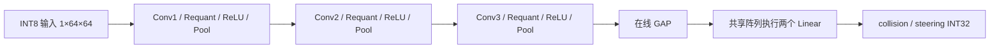

# RoadSence (CNN Accelerator)

**基于 PYNQ-Z2 的 INT8 双任务 CNN 加速器与行驶录像分析演示系统。**

RoadSence 将行驶录像中的采样图像送入 FPGA，完成碰撞风险与转向预测，再通过桌面界面展示结果。项目覆盖从量化模型、Verilog RTL、PS/PL 协同到板卡部署和视频演示的完整链路，核心是运行在 Zynq-7020 可编程逻辑（PL）上的 **8×16、128 PE 共享计算阵列**。

在 50 MHz 下，完整 CNN 的 RTL 验证结果为 **65,116 周期 / 1.30232 ms**，对应约 **767.86 次/秒的核心计算吞吐**；包含 PS7/AXI 集成的板级设计仅使用 **20 个 DSP、6.5 个 BRAM Tile**。这些指标的测量范围与原始证据见下文。

## 项目能做什么

- **双任务推理**：输入一张 `1×64×64` 的 INT8 灰度图像，PL 自动完成三层卷积块、全局平均池化（GAP）和两个 Linear 输出头，产生碰撞与转向的 INT32 结果。
- **软硬件协同**：PC 负责录像采样与展示，PS（ARM）负责图像预处理、PL 调用与结果解码，PL 承担 CNN 整网整数计算。
- **完整演示流程**：提供 Windows 准备工具、桌面程序、SSH 部署、镜像加载和真实图像推理检查。
- **可复现工程**：提供 RTL、模型参数、30 组 golden 样本、仿真测试、Vivado 构建脚本及板卡验收记录。


演示采用“先处理、后播放”：每 4 帧采样 1 帧，推理完成后按原视频帧率播放，未采样帧复用最近的采样结果。项目用于算法与 FPGA 工程展示，不提供车辆闭环控制。

## 快速使用

### 1. 准备环境

| 项目 | 要求 |
|---|---|
| 板卡 | PYNQ-Z2 / Zynq-7020，已有可启动的 PYNQ 3.1.1 参考 SD 系统 |
| 连接 | PC 与板卡网络互通，板卡 SSH 可用；首次安装依赖需要联网 |
| PC | 推荐 Windows x64；命令行支持 Python 3.9–3.12，需正常的 Tcl/Tk |
| 板端依赖 | PYNQ/XRT、NumPy、Pillow 9.0.1、gcc 与 libjpeg 开发包，见[板卡说明](board/README.md) |
| 硬件开发 | 仅重新构建镜像时需要 Vivado 2023.2 及 xc7z020 器件支持 |

运行随附镜像不需要安装 Vivado。Linux/macOS 提供命令行入口与 CI 配置，目前已验证依赖解析；实际桌面运行验收在 Windows x64 上完成。其他 FPGA 板卡需要重新构建和适配。

### 2. Windows 一键准备

```sh
git clone https://github.com/Soap7366/RoadSence-CNN-Accelerator.git
cd RoadSence-CNN-Accelerator
```

也可下载仓库 ZIP 并完整解压至可写目录。

1. 板卡插入已准备好的 SD 卡、通电，并用网线连接电脑。
2. 双击 **`Prepare.exe`**，输入板卡实际 IP（默认 `192.168.2.99`）和密码，点击“开始准备”。
3. 程序准备 Python 依赖，完成 SSH 连接、文件部署、板端构建、镜像加载与真实图像检查。需要配置网段时，选择连接板卡的有线网卡，并按 Windows 提示授权。
4. 出现“准备完成”后，双击 **`RoadSense.exe`**。
5. 在界面中依次选择 **连接板子 → 选择录像 → 处理录像 → 开始播放展示**。

两个 EXE 都是启动器，需要与整个项目文件夹一起保留。缺少 Python 时，准备工具会下载并验证官方安装程序，在 `.runtime/python312` 安装私有解释器；密码仅保存在当前进程内存中。工具不制作 SD 卡、不替换板卡系统。

准备失败时运行 `build/prepare.cmd` 查看输出，日志位于 `.runtime/prepare.log`。详细验收记录见[一键准备与运行](report/one_click_validation.md)。

### 3. 命令行使用

在项目目录执行；Linux/macOS 将 `python` 替换为 `python3`：

```sh
python manage.py setup
python manage.py test
python manage.py doctor --gui
python manage.py configure --host 192.168.2.99 --username xilinx
```

首次连接需要核对板卡 SSH 指纹。在板卡本地控制台运行 `ssh-keygen -lf /etc/ssh/ssh_host_ed25519_key.pub -E sha256`，将下面的占位内容替换为实际指纹：

```sh
python manage.py trust --fingerprint SHA256:实际核对过的目标主机指纹
python manage.py deploy
python manage.py board-check --boot
python manage.py smoke
python manage.py start
```

`setup` 自动创建独立虚拟环境，后续命令无须手动激活。`deploy` 会校验文件与模型/镜像身份；`smoke` 执行 golden 和 JPEG 推理检查。仅打开 GUI 不代表已完成板卡部署。

Linux 需安装 Tk 和 OpenCV 系统运行库，例如 Ubuntu 的 `python3-venv python3-tk libgl1 libglib2.0-0`。离线安装可使用 `python manage.py setup --offline --wheelhouse /path/to/wheels`，缓存需匹配目标系统、架构和 Python 版本。

## 核心亮点：PL 上的 CNN 加速器

### 整网硬件执行，一次启动完成双任务

加速器使用 QAT INT8 模型，输入与权重以 INT8 表示，乘累加结果使用 INT32。输入图像写入后，只需一次 `start`，硬件控制器便自动调度完整网络：



卷积、GAP 和两个输出头均在 PL 中完成；PS 负责最终反量化与碰撞概率的 sigmoid。层间数据通过片上 A/B 特征 RAM 交替传递，减少逐层由软件调度和搬运中间特征的需要。

### 三个关键设计

| 设计 | 实现方式 | 带来的收益 |
|---|---|---|
| **128 PE 共享阵列** | 8×16 MAC 阵列执行卷积，并复用于双 Linear | 复用计算资源，无须另建一套 FC 乘法器 |
| **在线 GAP** | Conv3 池化结果写入特征 RAM 的同时，累加各通道结果 | 与 Conv3 重叠执行，省去一次独立的完整特征图读取 |
| **整网自动调度** | 控制器完成层切换、参数加载、GAP 等待与结果锁存 | 一次启动得到两个预测头，计算周期固定，接口明确 |

相比三层卷积共 **64,773 周期**，加入在线 GAP、双 Linear 及相关交接后，整网只增加 **343 周期（6.86 μs，约 0.53%）**。这是本设计的一个主要优势：以很小的额外周期成本完成双任务网络尾部计算。

实现细节见[整网 RTL 设计](report/core_design.md)与[核心源码](src/core)。设计报告保留了原研发阶段的路径，当前复现请使用下文的 `manage.py` 入口。

### 性能：50 MHz 下约 1.3 ms 完成整网计算

以下延迟来自 **30 个样本的整网 RTL 仿真周期**，各样本均为 65,116 周期，按 50 MHz 换算：

| 阶段 | 周期 | 延迟 |
|---|---:|---:|
| Conv1 | 11,375 | 0.22750 ms |
| Conv2 | 19,538 | 0.39076 ms |
| Conv3（与在线 GAP 重叠） | 33,860 | 0.67720 ms |
| Linear 参数加载、特征复制及计算 | 333 | 6.66 μs |
| 网络启动与阶段交接 | 10 | 0.20 μs |
| **完整 CNN** | **65,116** | **1.30232 ms** |

- **核心计算吞吐：约 767.86 次/秒**，由整网延迟取倒数得到。
- **有效运算吞吐：约 4.076 GOPS**，按每次推理 2,654,272 MAC、每 MAC 为 2 次操作计算。
- **阵列理论峰值：12.8 GOPS**；整网有效 PE 利用率约 **31.85%**，包含内部参数加载与控制交接开销。

这些数据描述 PL 核心计算，不包含图像上传、PS 预处理、AXI 主机传输、结果回读及后处理，**不是端到端实测 FPS，也不是视频播放帧率**。当前没有同条件 CPU/GPU 对照测试，因此不宣称相应加速倍数。

原始周期和正确性记录：[整网 RTL 日志](sim/evidence/rtl_network.txt)。

### 资源：完整板级设计仍保留较大余量

以下采用仓库内**完整 PS7/AXI/CNN 板级设计**的重新布局布线报告，目标器件为 `xc7z020clg400-1`，与独立 CNN 核心的历史资源统计区分：

| 资源 | 使用量 | 器件占比 |
|---|---:|---:|
| LUT | 21,025 | 39.52% |
| FF | 19,115 | 17.97% |
| DSP48E1 | **20** | **9.09%** |
| BRAM Tile | **6.5** | **4.64%** |

128 个 PE 的 MAC 主要映射到 LUT，DSP 主要用于重定标乘法，因此 **20 个 DSP 不等于仅有 20 个 PE**。该实现以 LUT 承担主要计算，在 Zynq-7020 上保留了较多 DSP 与 BRAM 余量，为后续系统扩展提供空间。

该板级设计在 50 MHz 下的建立时间裕量为 **+4.600 ns**、保持时间裕量为 **+0.023 ns**。资源与时序证据：[资源报告](build/rebuilt_overlay/utilization.rpt)、[时序报告](build/rebuilt_overlay/timing_summary.rpt)。此重建镜像已完成构建和静态时序验证，尚未上板；已完成真实部署与视频演示验收的是随附的 `board/base` 镜像。

### 正确性：从整数参考到真实板卡

| 验证层级 | 已有结果 |
|---|---|
| 核心整网 RTL | 30 个样本全部通过，60 个最终 INT32 与 golden 一致 |
| 中间计算 | 1,720,320 个卷积 INT32、430,080 个池化值、960 个 GAP 求和与 960 个 GAP INT8 逐项一致 |
| 控制与接口 | 复位、busy 隔离、结果保持测试通过；AXI 桥 9 组协议/故障测试通过 |
| AXI 整网 | 30 个样本、60 个 INT32，经完整 AXI 写入与回读验证通过 |
| 真实板卡应用 | 随附原镜像完成独立部署、真实图像推理和录像处理/播放；新旧部署的 4 个采样帧输出逐项一致 |

Golden 一致性验证的是硬件与模型整数参考实现的一致性，不代表模型预测准确率为 100%。更多验证范围见[当前验证状态](report/validation_status.md)。

历史核心功耗分析还给出约 **0.218 W**、**18.7 GOPS/W** 的 Vivado 活动辅助估算，但活动直接匹配覆盖约 11%，且不包含活跃 PS、DDR 和整板供电损耗。这些仅作为研究参考，不作为板卡实测能效；详见[历史核心性能与功耗分析](report/core_performance.md)。

## 复现与硬件开发

使用 Vivado 2023.2，在 PATH 中配置工具，或按命令支持的参数显式指定 `--vivado-bin`：

```sh
python manage.py rtl sim --tests network gap linear control
python manage.py overlay sim
python manage.py overlay check
python manage.py overlay build
```

上述流程分别验证核心 RTL、AXI 接口和整网、工具与器件环境，并构建完整 PS7/AXI/CNN 镜像。构建产物位于 `.runtime` 下，命令完成时打印路径。新镜像需成对使用 bit/HWH 与 manifest，并单独上板验收：

```sh
python manage.py deploy --overlay /path/to/build_workspace/artifacts
python manage.py board-check --boot
python manage.py smoke
```

默认部署使用已验证的 `board/base/overlays/cnn_v1`；`build/rebuilt_overlay` 保存另一份已完成构建、尚未上板的重建产物。新构建不会自动替换默认镜像。

## 仓库导航

| 目录 / 入口 | 内容 |
|---|---|
| `Prepare.exe` / `RoadSense.exe` | Windows 环境准备与桌面演示入口 |
| `manage.py` | 安装、测试、部署、仿真与构建统一入口 |
| [src/core](src/core) | CNN RTL、测试平台与参数 |
| [src/integration](src/integration) | PS7/AXI/PL 板级集成 |
| [src/desktop](src/desktop) / [src/stream](src/stream) | 桌面应用与图像传输/处理 |
| [board](board) | 板端代码、默认镜像及实测证据 |
| [data](data) | 图像样本与模型合同 |
| [sim](sim) | 自动化验证与仿真证据 |
| [build](build) | 环境、部署、构建脚本与实现报告 |
| [report](report) | 设计、性能与验证说明 |

交付完整性检查与导出：

```sh
python manage.py verify
python manage.py export --output /path/to/new_delivery
```

导出不携带虚拟环境、密码、机器配置或本机运行产物。更多维护说明见[文件清单](report/file_inventory.md)和[维护记录](report/maintenance.md)。
