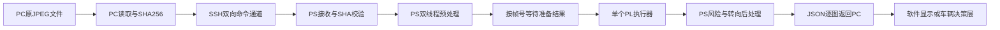

# PYNQ-Z2 CNN避障推理系统：软件设计交接文档

编写日期：2026-10-31（America/Los_Angeles）  
交接版本：systolic-cnn-stream-v0.3.0，已回退至原版运行逻辑  
交接基线：Git `731c001`，其文件内容与 `b96f575` 一致  
读者：上位机、板端软件、摄像头接入及车辆控制软件开发人员

## 1. 系统目标与已实现范围

系统面向机器人或小车行驶中的视觉避障。输入一张JPEG图像，输出碰撞风险分数和模型建议转向值。

当前已实现“PC发送原JPEG → PYNQ-Z2 PS完整预处理 → PL真实CNN推理 → PS后处理 → PC收到结果”的链路。当前入口是批次实验客户端，不是已经接入摄像头和电机的整车应用。

摄像头采集、实时帧调度、风险决策、速度控制、转向执行、车辆通信协议及界面由后续软件设计负责。既有推理链路可作为这些模块的基础。

碰撞风险是模型分数，不是距离、碰撞时间或已经完成现场校准的碰撞概率。转向值是模型标签空间中的弧度值，不能未经标定直接作为舵机命令。

## 2. 当前版本与回退状态

本次交接以回退后的原版为准：

- PC窗口仅支持1或2，默认2；PS默认两个预处理工作线程；PL串行执行。
- `b7b271e` 是曾经进行的发送窗口扩展实验；已由 `731c001` 撤销，不属于当前交付功能。
- 本地运行代码已回退，板端对应四个修改文件已恢复并读回核验，回退后板端28项测试全部通过。
- 原版中的少量旧注释/元信息随回退一起恢复，见第12节。不要根据它们判断实际链路。
- 仓库当前没有配置远程Git地址；提交保存在本地存储库。

## 3. 模块职责和数据流



| 模块 | 负责 | 主要文件 |
|---|---|---|
| PC客户端 | 选图、读取原JPEG、哈希、滑动窗口发送、接收校验、下载报告 | `tools/client_images.py` |
| PC测量启动器 | 将子Python启动及导入纳入测量起点 | `tools/run_measurement.py` |
| SSH连接 | 固定主机公钥校验、认证、TCP连接计时 | `tools/board_connection.py` |
| PS服务 | 初始化、协议接收、任务调度、按序推理、结果回传 | `tools/serve_images.py` |
| 原生预处理 | JPEG头检查、系数复用、调用C库 | `pscnn/fast_preprocess.py` |
| C图像算法 | 扫描行解码、NEON灰度、精确缩放、量化查表 | `native/exact_gray.c`、`native/exact_resize.c` |
| PL控制 | 输入检查、硬件事务和故障处理 | `pscnn/native_session.py`、`native/native_frame.c` |
| 硬件验证 | bit/HWH及地址验证、同次开机记录、MMIO映射 | `pscnn/overlay_artifact.py`、`pscnn/boot_state.py`、`pscnn/pinned_mmio.py` |
| 模型与输出 | 读取固定量化参数、INT32解码、风险与转向换算 | `pscnn/model.py`、`pscnn/postprocess.py` |

PC不做图像解码、缩放或量化。PS负责全部图像预处理；PL返回两个整数，sigmoid在PS执行。

## 4. 环境、路径与运行

### 4.1 当前环境

| 项目 | 当前值 |
|---|---|
| 板卡 | PYNQ-Z2，Zynq-7020 |
| 板端地址/用户 | `192.168.2.99` / `xilinx`，SSH端口22 |
| 板端项目 | `/home/xilinx/systolic-cnn-stream-v0.3.0` |
| 板端既有硬件包 | `/home/xilinx/systolic-cnn-v0.7.0` |
| 板端Python | `/usr/local/share/pynq-venv/bin/python3` |
| PC默认图像目录 | 工作区 `data/images` |
| PL接口 | AXI MMIO，物理基址 `0x40000000`，范围8192字节，配置时钟50 MHz |

板端服务通过sudo访问设备，依赖已经加载且与本次开机记录一致的PL镜像。服务启动会校验bit/HWH和开机记录，不负责每次重新烧写bit。

PC现有脚本还依赖相邻的 `SystolicCNN-Handoff-v0.9.5`：提供Python运行时、SSH依赖和固定主机公钥文件。不能只拷贝本目录后就假定PC端独立可运行。独立软件发布时需整理这些依赖和路径。

PS原生库包括 `libpscnn_preprocess.so`、`libpscnn_frame.so`、`libpscnn_mmio.so`；构建入口为 `native/build.sh`。图像处理依赖Pillow、系统libjpeg；CMYK回退路径还依赖NumPy。

凭据由运行时交互输入，不在本交接文档中保存。不要将密码写入代码、日志或界面配置样例。现有客户端使用固定SSH主机公钥校验。

### 4.2 PC运行命令

在本项目目录的PowerShell中执行：

```powershell
& ..\SystolicCNN-Handoff-v0.9.5\pc\runtime\python.exe -B tools/run_measurement.py --limit 10 --runs 3
```

指定图像目录和默认行为的完整示例：

```powershell
& ..\SystolicCNN-Handoff-v0.9.5\pc\runtime\python.exe -B tools/run_measurement.py --input-dir D:\work\FPGA\data\images --limit 10 --runs 3 --window 2 --workers 2 --preprocess native --ack-words 1 --golden 0
```

当前客户端按文件名排序选取目录下的 `*.jpg`；不是实时摄像头入口，也未实现递归扫描或全部图像格式识别。

| 参数 | 含义 |
|---|---|
| `--window 1/2` | 已发送但尚未收到结果的最大帧数，默认2 |
| `--workers 1/2` | PS预处理工作线程数，默认2 |
| `--preprocess native/reference` | 原生精确预处理或原Pillow参考路径 |
| `--ack-words 1` | 默认每写一个32位字检查输入计数；交付验收使用此设置 |
| `--golden 0/30` | 默认不额外推理golden；30表示初始化时验证30个硬件样本 |
| `--full-wire-report` | 每张返回完整诊断数据，会增加回传开销 |

正常会话复用一次SSH连接和PS初始化。结束时服务退出，无新增常驻进程。

## 5. 图像与模型输入合同

原生路径的输入要求：JPEG，单文件不超过8 MiB；宽高均为1～4096，像素数不超过1600万。每会话最多缓存32组不同尺寸的缩放系数。RGB/L进入原生路径；其他JPEG模式显式走参考路径，CMYK已包含测试。

每张图执行：

1. 读取JPEG头，检查尺寸和模式。
2. libjpeg按原尺寸解码，按扫描行灰度化与水平缩放。
3. 垂直缩放得到64×64灰度图；水平和垂直分别执行与原Pillow路径一致的舍入。
4. 通过PS启动时构造的256项表，实现原float32归一化及INT8量化的等价映射。
5. 生成4096字节的单通道模型输入。

| 字段 | 合同 |
|---|---|
| 模型 | `dual_task_baseline2_int8_qat@619308c77fd9` |
| 输入形状 | `[1, 1, 64, 64]` |
| 布局 | NCHW，C-order；单通道行优先 |
| 类型/长度 | INT8 / 4096字节 |
| 实际输入范围 | 0～127 |
| 输入scale/zero point | `1/127` / `0` |

缩放是整幅图像直接变为64×64，当前没有裁剪、letterbox或保持长宽比的填充。后续摄像头接入应先确认视野和训练分布，不能擅自改变预处理。

量化表和缩放系数是算法数据复用，不是图像或预测缓存。每张JPEG实际解码，每张图实际进入PL。

替换图像库、解码模式、缩放算法或量化实现时，验收标准是最终4096字节逐字节一致；仅比较视觉效果或近似浮点值不够。

## 6. PC与PS通信协议

### 6.1 传输方式

当前不是独立TCP推理服务或HTTP接口。PC通过SSH启动一次PS脚本，向命令stdin发送二进制协议，从stdout接收JSON Lines。sudo认证在发送任何协议字节之前完成，客户端必须等到 `ready` 才能发请求。

SSH为字节流，一次send不等于一次recv。实现必须按长度收满头和正文，并缓存拆分或合并的JSON行。stdout只用于协议消息；诊断输出应写stderr或报告文件。

### 6.2 二进制请求头

固定44字节，Python格式 `!4sII32s`；整数为网络字节序无符号32位。

| 偏移 | 长度 | 含义 |
|---:|---:|---|
| 0 | 4 | 消息类型ASCII |
| 4 | 4 | 序号：按类型解释为run_id或frame_id |
| 8 | 4 | 长度/数量：按类型解释 |
| 12 | 32 | SHA256原始摘要字节，不是64字符hex文本 |

| 类型 | 序号字段 | 长度/数量字段 | SHA与正文 |
|---|---|---|---|
| `BEG1` | run_id | 本批帧数，1～100000 | SHA全0，无正文 |
| `IMG1` | frame_id，从0连续递增 | JPEG字节数 | JPEG的SHA256；随后紧接原JPEG字节 |
| `END1` | 当前run_id | 0 | SHA全0，无正文 |
| `BYE1` | 现有客户端发0 | 0 | SHA全0，无正文 |

### 6.3 会话时序

```text
PC启动SSH命令 → PS ready
PC BEG1 → PS run_start
PC IMG1(frame=0), IMG1(frame=1)
PS image_result(frame=0) → PC释放一个名额，再发frame=2
……每收到一个结果补一张，最多两张在途……
PC全部图像发完后发送END1（此时最后若干结果可以尚未返回）
PS按序返回全部image_result → run_complete
可再开始下一批BEG1
PC BYE1 → 关闭发送方向 → PS service_complete → 服务退出
PC下载board_summary并关闭SSH
```

PS两个工作线程可同时预处理，但主线程按提交顺序等待future，不能因后图先准备完成而越序推理。当前批次间不交错，完成一批后再开始下一批。

## 7. 返回数据合同

所有返回都是UTF-8 JSON，每条以换行结束。主要事件包括 `ready`、`run_start`、`image_result`、`run_complete`、`service_complete`。

默认精简 `image_result` 主要字段：

| 字段 | 含义 |
|---|---|
| `event` | 固定 `image_result` |
| `run_id` / `frame_id` | 批次和帧号 |
| `source_sha256` | 原JPEG摘要的hex字符串 |
| `input_sha256` | 最终4096字节INT8输入摘要 |
| `raw.collision_int32` | 有符号32位碰撞输出 |
| `raw.steering_int32` | 有符号32位转向输出 |
| `decoded.risk_score` | sigmoid后的0～1风险分数 |
| `decoded.collision_logit` | sigmoid之前的实数值 |
| `decoded.steering_value` | 标签空间转向值 |
| `decoded.steering_units` | `rad_label_space` |
| `native.readback_verified` | 完整输入回读通过标志 |
| `native.count_checks` | 默认应为1024 |
| `native.bytes_read` / `bytes_written` | 每帧均应为4096 |
| `native.result_seq` | PL结果序号；全会话连续，32位回绕 |

`decoded` 中还保留两个原始INT32。默认精简回包没有完整逐阶段计时，完整数据在板端报告中；不要将可选诊断字段视为默认必有字段。

后处理公式：

```text
collision_logit = collision_int32 × 0.0001111633778391911
risk_score      = sigmoid(collision_logit)
steering_value  = steering_int32 × 0.000048765890998470586
```

以上常数来源于当前固定模型的 `config/quant_params.json`。应用应复用返回的 `decoded`，不要再做一次sigmoid或额外除以127。更换模型时必须同步合同和量化参数，不能继续使用本文常数。

当前服务调用后处理时未传风险阈值，因此默认没有 `collision_class` 或 `risk_threshold`。软件层需另外制定阈值及策略。

## 8. PS与PL交互及异常

PS以设备文件锁保证硬件独占，NativeSession另有进程内互斥。不要启动两个服务同时控制同一个PL。

每图执行身份检查、复位确认、1024次32位输入写入及默认1024次计数检查、1024次输入回读比较、启动确认、完成等待和输出稳定性检查。默认每图PL调用超时为2秒。MMIO包含有序访问屏障，当前没有DMA。

非法协议、摘要错误、截断图像、预处理失败、帧号异常、硬件身份或状态异常、超时等会导致本次服务失败。服务主逻辑通常记录错误并发送 `service_complete`，但启动早期异常、断网或进程崩溃也可能直接中断，不能假定总能收到错误JSON。

当前协议没有逐帧错误后继续运行的合同，也没有自动重连续传、幂等重试或断点恢复。发生会话级错误后，应关闭旧连接，确认旧服务已退出和设备可用，再开始新会话；不要把旧连接残留结果归入新批次。

软件设计建议：

- 校验run/frame、源摘要、完整回读标志和输出数值有效性；状态异常不更新控制输出。
- 将连接、初始化、运行、故障和退出状态明确呈现；失败信息保留到诊断日志。
- 车辆侧定义结果超时及失联后的停车/降速行为，具体阈值由整车团队确定。
- 需要重试时分配新的应用会话标识；现协议的run_id/frame_id不能独立标识不同SSH会话。

## 9. 实时接入与车辆控制的待设计事项

以下是新增软件工作，不代表当前代码已经实现：

| 事项 | 需要确定的内容 |
|---|---|
| 摄像头接入 | 相机安装、分辨率、JPEG编码、采集频率和颜色语义 |
| 帧时效 | 采集时间戳、结果对应帧、允许最大帧龄、积压帧如何丢弃 |
| 持续运行 | 当前有限批次协议如何映射实时流；退出、换批及重连策略 |
| 风险策略 | 阈值、迟滞/滤波、减速/停车/绕行关系及现场标定 |
| 转向执行 | 正负方向、弧度到实际轮角/舵机值的映射、中位、限幅和变化率 |
| 车辆通信 | 串口/CAN/其他协议、命令反馈、控制频率和故障状态 |
| 界面与日志 | 原图、对应帧结果、连接状态、推理延迟、异常及运行记录 |

实时场景应优先处理最新且可追溯的图像，避免在采集端无界排队。现有frame_id要求连续；若在发送前丢弃旧帧，应为实际发送帧重新分配连续协议编号，并在应用层另存原始采集帧号。直接跳过协议frame_id会被服务拒绝。

新协议或应用消息可增加session_id、capture_frame_id、采集时间戳和策略版本；现有IMG1头没有这些字段，扩展时需要同步PC/PS并明确版本。

## 10. 性能口径与现有限制

原版最终会话 `job_9cc72f8c869f` 的已存数据：

| 指标 | 结果 |
|---|---|
| 稳定段10张批次平均 | 528.377 ms |
| 批次吞吐 | 18.93张/秒 |
| 稳定批次PC读图到结果平均 | 约102 ms/张 |
| PS单图预处理平均 | 77.646 ms |
| 其中JPEG扫描行解码累计 | 52.881 ms |
| Python PL推理入口平均 | 3.853 ms，含写入、回读与检查 |
| PC启动到ready | 约5.47秒，包含连接与初始化 |

测试图为960×720 JPEG。双线程存在重叠，不能把单图各阶段简单累加为批次耗时，也不能用18.93张/秒反推每张延迟约53 ms。

PC/PS未同步时钟，不能直接相减两端绝对时间戳得到单向网络延迟。sendall耗时和阻塞recv包含缓冲、等待及调度，不是纯网线时间。

已有实验出现CRC错误、长发送等待及连接超时。吞吐不构成实时期限保证；当前最大CPU项仍是PS JPEG解码。窗口加大实验已回退，其结果不作为当前功能或性能承诺。

## 11. 验收、诊断与证据

PC单测：

```powershell
& ..\SystolicCNN-Handoff-v0.9.5\pc\runtime\python.exe -B -m unittest discover -s tests
```

Windows下原测试为28项，10项通过、18项ARM专用跳过；板端28项全部通过。真实硬件回归可用客户端 `--golden 30`，该操作会实际运行30个golden，不是只读检查。

后续修改建议按以下条件验收：

1. 原JPEG身份及最终INT8输入SHA保持一致。
2. 双INT32及后处理值与原版逐图一致，无缓存预测、丢帧或乱序。
3. 每图全回读、默认1024次计数检查和连续PL序号通过。
4. 保留失败和慢会话，检查前后网络错误计数，区分启动、批次吞吐和单图延迟。
5. 原生算法修改在ARM板端执行测试；Windows跳过不能替代板端验证。

| 证据 | 用途 |
|---|---|
| [最新测试报告](最新测试报告.md) | 原版阶段耗时、完整验证和异常记录 |
| [按时间顺序详解](按时间顺序详解.md) | 原最终30张逐图时间轴 |
| `results/job_9cc72f8c869f/pc_summary.json` | 原版PC原始记录 |
| `results/job_9cc72f8c869f/board_summary.json` | 原版PS完整记录 |
| `VALIDATION.json` | 原版180次真实推理的逐项验收汇总 |
| `DEPLOYMENT.json`、`SOURCE_MANIFEST.json` | 原部署/编译/源码身份记录 |
| `FINAL_SOURCE_CHECK.json` | 原最终源码与部署的核查记录 |
| `board_backup/v010_before_ps_opt.tar.gz` | 更早v0.1.0板端备份，不是本次v0.3.0回退包 |

这些文件是对应实验时点的证据，不应把历史清单当作会自动更新的实时设备状态。

## 12. 已知描述遗留和交接注意事项

由于上一轮修改已整体回退，当前原版存在以下描述遗留：

- `config/model_contract.json` 的 `hardware_backend_implemented: false` 和 `axi_register_map: null` 为旧元信息；实际服务已有硬件后端，寄存器表在 `config/axi_registers_v1.json`。
- `pscnn/cli.py` 的部分环境说明和硬件入口提示仍是早期版本内容；本版本真实图像硬件入口以 `tools/serve_images.py` 和 `tools/client_images.py` 为准。
- PC/PS入口顶部部分注释仍描述发送64×64灰度图；实际IMG1传输的是原JPEG。

本交接文档记录实际代码行为，没有再次修改上述运行文件。软件接手后如要清理，应单独提交并验证，避免与模型或协议变更混在一起。

开始设计时，先用既有PC客户端完成默认10图回归，再把“采集 → 原JPEG → 推理会话 → 对应帧结果 → 车辆决策”接起来。车辆策略、角度映射和实时帧管理的约定应形成单独的应用接口合同。
