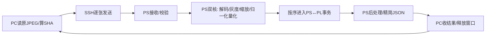

# v0.3.0：PS完整图像预处理的优化与全流程实测

日期：2026-11-01，Asia/Shanghai；持续时间采用PC/板端各自单调时钟。

**保持PC发送原JPEG、PS负责全部图像预处理、PL不变。最终方案后两批平均 528.377 ms/10张，批次吞吐 18.93张/秒；同框架原Pillow单线程对照 1081.543 ms/10张，约加速2.05倍。**

所有成功会话共 **180次真实PL推理**，原JPEG身份、最终INT8字节SHA、PL双INT32、风险及转向均与原v0.7.0逐图一致。最终会话30图全部通过。不同阶段的调试会话、慢会话和连接超时全部保留。

## 保存和范围

v0.1.0保留在原目录，基线提交c01c62c；v0.2.0及其归档原样保留。新代码独立放在 `systolic-cnn-stream-v0.3.0`，板端 `/home/xilinx/systolic-cnn-stream-v0.3.0`。板端v0.1.0在部署前再次备份并下载到board_backup/v010_before_ps_opt.tar.gz。没有改PL RTL、bit、50MHz配置或模型。

## 逐项分析及采用的优化

| 位置 | 原开销/问题 | 已采用处理 | 实际结论 |
|---|---|---|---|
| PC启动 | 导入协议顺带拉入NumPy/Pillow | 协议与图像算法分离，PC只导入轻量收发模块 | PC不做解码/灰度/缩放；减少无用模块 |
| PS启动 | native_session经control→preprocess隐式导入NumPy | 共用轻量错误类型；ctypes替代NumPy MMIO视图 | 最终ready时numpy_loaded=False；映射仍为有序C访问 |
| PS预处理 | 完整Pillow RGB/灰度对象与通用缩放循环 | libjpeg扫描行解码→NEON等价灰度→22位系数两次uint8舍入缩放 | 不改变图像视野、IDCT模式或模型输入；按输入SHA验收 |
| PS量化 | 每图4096个像素重复执行float32/float64数组运算 | 启动时按原算式建立256项表，每图只查表 | 已穷举256灰度值比对；这是算法表，不是图像/预测缓存 |
| PS并行 | 单核线程做图像准备 | 两工作线程使用双核，按原序号取future | 同时最多两张在途，PL独占且一次一张 |
| PS接收 | JPEG SHA在接收和准备阶段各算一次 | 复用接收时实际已校验的SHA | 保留传输完整性，取消一遍140KB哈希 |
| 网络接收 | PC每0.5ms循环检查channel | 专用线程阻塞recv、完整JSON行立即分发 | 无需固定轮询间隔，阻塞等待不计作CPU处理 |
| 返回 | 每张回传约2.2KB完整计时 | 逐图只回结果及必要校验；全计时一次性下载 | 最终约582字节/图，完整数据保存在board_summary |
| 诊断 | 另开SSH命令/Python采样前后网络状态 | 在已有PS进程采样、结束事件携带 | 去掉两次额外Python/exec启动，仍有成对网络计数 |
| PS↔PL | 原生事务约2.7ms | 保留逐字计数、全部回读、身份/序号/超时 | 占比小，未以取消完整性验证换性能 |

简单替换OpenCV解码的微基准没有收益：自动模式解码均值94.346ms，强制NEON探针79.804ms，仍慢于本次直接libjpeg扫描行路径，未用于最终方案。该探针进程中的强制环境变量未写入系统配置，最终代码不设置该变量。证据见results/probe_auto.json及probe_neon.json。

## 最终实际流程：仍是逐张传、逐张返回

1. PC启动→加载依赖→读取已授权凭据→固定公钥SSH连接/认证→启动一条PS命令并保留双向通道。
2. PS导入轻量模块/Pillow→读模型参数→校验bit/HWH/SHA/地址→获取设备锁→检查同次开机PL记录→映射MMIO→创建PL控制会话和图像预处理器→建立256项表→创建双工作线程池→返回ready。正常不跑30次golden。
3. PC发BEG1、等run_start；逐张读原JPEG、算SHA、构造44字节头、发送原JPEG。最多两张在途。PC不做任何图像变换。
4. PS收头、收JPEG正文、验SHA，将任务交给图像线程。两个PS任务可以并行；每个任务都真正解码该JPEG。
5. 单图内部：解析尺寸/模式→获取缩放系数→初始化libjpeg→【解码一批扫描行→NEON灰度→水平缩放】反复执行→结束解码→垂直缩放→归一化/量化等价查表→生成4096字节INT8。不是先解码全部图片。
6. 主线程严格按帧号取准备结果→输入检查/SHA→PL身份→复位→写入/逐字确认→完整回读→启动→等待→读输出/序号校验→风险和转向后处理→JSON立即返回。PL一次只处理一张。
7. PC收到某图就验证序号及回读标志并释放在途名额，继续发送下一张。即使后图预处理先完成，也必须等前图完成PL并按序返回。
8. 第10张发完后END1→收齐10张及run_complete。后续批次复用SSH和初始化；最后BYE1→PS释放资源、网络采样、统一写报告→退出→PC下载报告→关闭SSH。

## 同框架对照与最终3批数据

| 方案 | 设置 | 后两批平均10图 ms | 批次吞吐 张/s |
|---|---|---|---|
| 原Pillow参考预处理 | job_4aeefbca98cb；workers=1 | 1081.543 | 9.25 |
| 原生精确预处理 | job_fcbf1813f4b5；workers=1 | 758.925 | 13.18 |
| 最终原生精确预处理 | job_9cc72f8c869f；workers=2 | 528.377 | 18.93 |

| 批次 | 10图总计 ms | 相邻结果间隔均值 ms | 间隔最小～最大 ms | PC读图→结果均值 ms | PC发送→结果均值 ms |
|---|---|---|---|---|---|
| 1 | 598.788 | 50.733 | 34.568～66.702 | 113.459 | 112.748 |
| 2 | 516.650 | 46.389 | 3.822～94.227 | 101.900 | 101.278 |
| 3 | 540.104 | 48.648 | 14.114～89.416 | 102.717 | 102.047 |

双工作线程会形成成对返回；不能把约48ms的平均间隔解释成每隔48ms必然出一张，也不能用其倒数代替含批次起止开销的整体吞吐。每批9个相邻差值、单张延迟与10图批次为不同指标。

## PC从开始到全部结束的时间轴
起点是测量启动器首个perf_counter调用；包含子客户端解释器进入和导入，不含启动器自身此前的系统启动开销。

| 事件 | 距开始 s |
|---|---|
| PC子客户端进入 | 0.042834 |
| SSH认证连接完成 | 2.505261 |
| PS ready传回PC | 5.469980 |
| 首张结果传回PC | 5.612030 |
| 第1批10张结果收齐 | 6.068623 |
| 第2批10张结果收齐 | 6.585246 |
| 第3批10张结果收齐 | 7.125523 |
| PS退出/报告下载/SSH关闭完成 | 7.470535 |

结束点不含最后一次本地pc_summary序列化写盘、离线数值验证和报告生成；部署/编译/单元测试也不混入推理时间。

## 一次性PC导入、连接和退出：每小步

| PC启动小步 | 耗时 ms |
|---|---|
| PC标准库/路径准备 | 23.320000 |
| 轻量IMG1协议模块（无NumPy/Pillow） | 1.621500 |
| Paramiko/SSH模块 | 384.712400 |
| 启动器准备/创建子进程/子Python进入 | 42.833800 |
| 导入至main间隔 | 0.011300 |
| 参数解析、选10图、创建结果目录 | 2.857000 |

| 连接小步 | 耗时 ms |
|---|---|
| 读取已授权凭据（仅内存） | 0.316500 |
| 创建客户端/加载固定主机公钥 | 0.290700 |
| TCP连接192.168.2.99:22 | 200.430300 |
| SSH握手/密钥协商 | 187.355300 |
| SSH密码认证 | 1660.703900 |
| SSH connect父项（含握手/主机公钥验证/认证） | 1848.790200 |

| 会话操作 | 起止距开始 s | 耗时 ms |
|---|---|---|
| 凭据读取/建立SSH/认证 | 0.455361→2.505261 | 2049.900000 |
| 命令发起→PC收到ready | 2.505281→5.470077 | 2964.792500 |
| BYE/关闭PS映射/采样网络/写汇总/退出等待 | 7.125766→7.398072 | 272.305700 |
| SFTP下载全部板端计时报告 | 7.398080→7.470235 | 72.154500 |
| 关闭SSH连接 | 7.470242→7.470532 | 0.289700 |

命令通道打开/exec请求 **338.228900 ms**；命令到ready **2964.792500 ms**，其中板端脚本 **1021.862805 ms**；剩余 **1604.700795 ms** 包含远程调度、sudo、Python首次计时前进入、ready返回等，尚未继续拆分。保留认证和sudo授权，不把未测部分冒称纯网络。

## 一次性PS初始化：每小步

| PS启动步骤 | 耗时 ms |
|---|---|
| PS标准库/路径准备 | 159.383464 |
| 模型模块及标准依赖导入 | 121.195298 |
| bit/HWH验证模块与XML依赖导入 | 47.578800 |
| 轻量boot/native/MMIO模块导入（无NumPy） | 188.590400 |
| Pillow JPEG及PS原生预处理模块导入 | 213.643126 |
| 参数解析/创建板端输出目录 | 24.494326 |
| 导入结束到main间隔 | 0.040505 |
| 模型合同、量化参数读取与SHA检查 | 5.087262 |
| bit/HWH/身份/地址验证父项 | 216.135600 |
| 获取设备独占锁 | 0.407132 |
| 检查同次开机已加载记录 | 5.381538 |
| 检查开机记录/加载有序MMIO库/映射8192字节/dev/mem | 6.522948 |
| 加载PL控制C库/ABI检查/建会话 | 1.921846 |
| 读硬件ABI、状态、错误检查可用 | 0.247797 |
| 建立256项精确量化表/加载PS预处理C库 | 8.519434 |
| 在已有进程中读取测试前网络计数 | 8.556560 |
| 创建有界队列/双工作线程池/接收线程 | 13.139662 |

| bit/HWH验证父项内部 | 耗时 ms |
|---|---|
| 读取清单/解析JSON/模型身份/构建证据检查 | 1.802258 |
| 读取4,045,678字节bit | 20.845723 |
| bit SHA256 | 100.648216 |
| 读取141,362字节HWH | 0.895612 |
| HWH SHA256 | 3.637133 |
| 解析HWH XML、校验0x40000000/8192字节地址范围 | 79.531686 |

量化表构建 **6.919920 ms**，包含在preprocessor_init父项。PS总启动 **1021.862805 ms**；上述顶层阶段外的控制/计时/对象整理余量 **1.017107 ms**。ready时NumPy是否加载：`False`。同框架参考模式PS启动 **1868.623370 ms**。

bit/HWH仍完整读文件、算SHA、解析地址，不重新烧写bit。该步骤约0.22秒仅执行一次，未以删除硬件身份检查换取启动时间。量化查表不是移交PC执行，表和每张应用均发生在PS。

## 逐图PC小步（最终会话30张次均值）

| 步骤 | 平均 ms | 具体工作 |
|---|---|---|
| 等待两张在途窗口空位 | 39.494580 | 此等待发生在读取该图之前，不属于预处理 |
| 读取原JPEG | 0.476170 | PC只读压缩文件，没有解码、灰度或缩放 |
| 原JPEG SHA256 | 0.170397 | 确认本次图像身份；与原实验比对 |
| 构造44字节IMG1头 | 0.004927 | 类型4字节、帧号4、长度4、SHA256共32 |
| 拼接头和JPEG | 0.016063 | 未经重新编码的原JPEG字节 |
| 交给SSH通道 | 5.956287 | 包括Paramiko发送和可能的流控等待，不表示PS收齐 |

每张原JPEG平均 **140698.4字节**，原10张合计 **1,406,984字节**；每帧另加44字节协议头。不是4096字节灰度传输。

## 逐图PS接收与图像预处理：每一算法小步

| 步骤 | 平均 ms | 具体工作 |
|---|---|---|
| PS等待/读取消息头 | 36.168094 | 含PC限流及上一个/下一个请求间的空闲，不是纯传输 |
| PS解析消息头 | 0.030495 | 确认IMG1、帧号、长度边界 |
| PS读原JPEG正文 | 6.164073 | read_exact收齐；若已在缓冲区，可很快返回 |
| PS SHA256校验原JPEG | 3.863303 | 使用本次实际算出的哈希作为结果身份，取消后续重复计算 |

| 队列步骤 | 平均 ms |
|---|---|
| 接收完且SHA通过→工作线程开始（提交/排队/线程调度） | 1.140966 |

| 步骤 | 平均 ms | 具体工作 |
|---|---|---|
| PS解析JPEG尺寸/模式 | 2.199707 | Pillow限定JPEG，检查支持模式与尺寸上限 |
| 获取/首次生成缩放系数 | 0.076511 | 尺寸相同复用22位定点系数，不缓存任何图像或预测 |
| 准备PS原生预处理调用 | 0.071353 | 分配4096字节输出缓冲、输入指针、计时报告 |
| C初始化JPEG解码器/解析头 | 0.052959 | 原尺寸解码，不使用低分辨率draft或近似IDCT |
| C启动解码/申请行缓冲 | 0.099154 | 设置BGR输出、ISLOW IDCT、fancy upsampling |
| C按扫描行解码JPEG（累计） | 52.880616 | 本批每张720次调用；逐行处理，不构造整幅RGB中间对象 |
| C NEON灰度化（累计） | 5.263450 | 与Pillow L24整数公式一致 |
| C NEON水平方向缩放（累计） | 12.623572 | 22位系数累加→加半单位→右移22位→uint8中间值 |
| C结束JPEG解码 | 0.012711 | 验证完整解码、拒绝截断/解码警告 |
| C NEON垂直方向缩放 | 0.755941 | 再次22位系数累加和独立uint8舍入，得到64×64 |
| PS执行归一化/量化等价查表 | 0.050556 | 每个0～255灰度值映射到原float32/half-away算法的INT8值 |
| PS提取4096字节INT8输入 | 0.019417 | C输出复制为Python bytes |

| PS预处理父项/补充 | 平均 ms |
|---|---|
| Python预处理入口总计 | 77.645592 |
| 其中ctypes调用父项（C及语言切换/线程调度） | 75.110011 |
| 其中C原生预处理父项 | 74.997754 |
| C父项除上述8段外的计时/循环/释放等余量 | 3.258795 |
| 预处理结束→进入PL推理（保序/队列/调度） | 0.700891 |

每图实测解码扫描行调用 **720次**，尺寸960×720。真实内部顺序是『解码一批行→灰度→水平缩放』循环，上表三个计时是各次循环累加，不能误读成整幅解码后再整幅灰度。每行/每个像素没有单独写日志；两核争用与调度也计入墙钟时间。

灰度公式等价于 `(19595*R + 38470*G + 7471*B + 32768) >> 16`。水平、垂直分别按Pillow 9.0.1的22位权重和两次uint8舍入，不能替换成普通OpenCV resize。该语义依据[Pillow灰度源码](https://github.com/python-pillow/Pillow/blob/9.0.1/src/libImaging/Convert.c)和[Pillow重采样源码](https://github.com/python-pillow/Pillow/blob/9.0.1/src/libImaging/Resample.c)，同时以原算法的实际字节为验收标准。

256项表在PS启动时对每个灰度v，严格生成 `float32(v/255) → float32(结果/float32(1/127)) → float64 half-away舍入 → clip → INT8`。每张4096个像素查表完成与归一化/量化相同的映射；已穷举256种输入值验证。不是省略归一化/量化，也不是缓存某张图的结果。

## 逐图PS↔PL：每一步（原PL控制C未改）

| 步骤 | 平均 ms | 具体工作 |
|---|---|---|
| Python检查推理参数/计算INT8 SHA | 0.224401 | 保留独占锁、超时、4096长度、输入身份 |
| 准备PL原生调用参数 | 0.019579 | ctypes指针/报告 |
| C读取PL身份 | 0.010082 | magic、ABI、输入长度、8字量化SHA、5字模型commit |
| C复位并确认 | 0.010179 | 读reset_seq，写CONTROL=1，确认序号+1、空闲/输入计数0 |
| C写入4096字节输入 | 0.780187 | 1024次32-bit写，每字读取INPUT_COUNT确认，共1024次确认 |
| C完整回读比较 | 0.627952 | 1024次32-bit读，与全部4096字节逐字比较 |
| C启动并观察完成 | 1.486556 | 写CONTROL=2，确认start_seq，轮询状态/错误至DONE |
| C读取输出和稳定性检查 | 0.015377 | 读RESULT_SEQ/碰撞/转向，再读序号及状态确保一致 |
| PS整理C报告 | 0.225964 | 提取状态/计时/错误标志 |
| PS将寄存器值转signed INT32 | 0.091585 | 按补码解码两个结果 |

| 父项/剩余 | 平均 ms |
|---|---|
| Python PL推理入口总计 | 3.852803 |
| 其中ctypes调用父项 | 3.225823 |
| 其中C事务父项 | 2.942711 |
| C事务初始状态/循环/计时等已列6段之外余量 | 0.012377 |

每图固定1024次输入字写+1024次INPUT_COUNT确认+1024次输入字回读、1次复位和1次启动，总写次数1026。实际寄存器读次数 **2418～2730次/图**，因轮询不同而变化。AXI MMIO有序屏障保持，未改DMA。

启动→软件观察完成均值 **1.486556 ms** 包含CPU调度/轮询。双核图像任务繁忙时观察可被推迟，不能据此认定PL硬件变慢。本次未读取独立硬件周期计数，也未单独计时每个AXI总线物理事务。

## 逐图后处理、回传、PC收到：每小步

| 步骤 | 平均 ms | 具体工作 |
|---|---|---|
| PS风险/转向后处理 | 0.080220 | 碰撞int32×scale→sigmoid，转向int32×scale |
| PS结果JSON编码 | 0.317325 | 只编码结果、图像身份和必要完整性标志；详细计时不逐图上传 |
| PS写入stdout缓冲 | 0.012456 | 写本次SSH命令的结果管道 |
| PS刷新输出管道 | 0.137813 | 进入SSH返回路径，不表示PC已收到 |

| PC接收步骤 | 平均 ms |
|---|---|
| 阻塞recv等待并取出数据（含等PS计算/下一响应，非CPU处理） | 54.916343 |
| JSON解析 | 0.047160 |
| 检查run/frame和完整回读标志 | 0.002153 |
| 收到完整JSON行→主线程验证完成父项 | 0.113760 |

逐图返回平均 **581.8应用层字节**。完整所有计时只在板端保留，结束后下载board_summary。PC发送→收到结果，扣除PS『已收齐并校验→开始结果编码』后的合并余量 **21.812074 ms**；包含上下行SSH、收齐/验SHA、结果JSON/flush、调度。该余量与前述部分软件小步重叠，不能再次相加。

**边界说明：未同步PC/PS时钟，不直接相减跨机绝对时间戳。PC sendall、PS读头等待和阻塞recv均不能冒称单向网线传输。没有逐包测以太网延迟，没有逐条测AXI物理延迟。软件阶段给出真实时段；未进一步分开的SSH/sudo/调度保留父项，不用理论带宽时间替代。**

## 为什么还不能把所有行相加

两张图在PS双核并行，当前图的PS/PL阶段可能与下一图接收/解码重叠；各表还同时列出父项和子项。PS单图约78ms不代表78ms才出一张；两核并行后批次约0.53秒/10图。首批有启动首用开销，后两批用于稳定段对照。

## 尚存的可优化点与未采用处理

| 项 | 判断与后续方向 |
|---|---|
| 链路稳定性 | 出现成对CRC增量及长sendall，优先检查网线/连接器/PC网口；本轮没有改网卡配置或物理连接。纯软件优化不能保证消除物理链路错误 |
| PS JPEG解码 | 最终解码约53ms/图，仍最大单图CPU项。可研究更优编译/解码库，但必须逐字节验收；直接luma解码、draft缩小、fast IDCT可能改变输入，未采用 |
| PS双核调度 | 双核任务与SSH/PL轮询争用CPU，平均间隔下降但有突发；若更重视延迟平稳，可用workers=1，约0.76秒/10图 |
| 会话启动 | 认证、sudo、Python进入存在一次性秒级开销；当前同会话复用，不额外安装常驻root服务或改开机行为 |
| 硬件文件校验 | 约0.22秒一次，保留完整身份链。可部署受控常驻服务摊薄，但不是每图瓶颈 |
| PS↔PL | 输入写/回读约1.4ms，取消逐字确认收益有限。此次保留，不以削弱输入检查换取很小改善 |

## 所有本轮会话，包括失败和慢会话

| job | 算法/工作线程 | 状态 | 各批10图 s | CRC增量 |
|---|---|---|---|---|
| job_28fd5d2b3f7f | native/1 | PASS | 0.791646, 0.764160, 0.765085 | 0 |
| job_4aeefbca98cb | reference/1 | PASS | 1.115649, 1.081730, 1.081355 | 0 |
| job_58d4ffe66e1d | native/2 | PASS | 16.788609, 5.380548, 7.822584 | 352 |
| job_9cc72f8c869f | native/2 | PASS | 0.598788, 0.516650, 0.540104 | 0 |
| job_bdae0433374f | native/2 | PASS | 0.585570, 0.533437, 0.536223 | 0 |
| job_bead2490fda2 | native/2 | FAIL | {'type': 'TimeoutError', 'message': 'timed out'} | 未运行图像 |
| job_eda3e3a5129c | native/1 | FAIL | {'type': 'TimeoutError', 'message': 'timed out'} | 未运行图像 |
| job_fcbf1813f4b5 | native/1 | PASS | 0.793276, 0.751955, 0.765895 | 0 |

慢会话job_58d4ffe66e1d：最长sendall 11.253秒，PS预处理仍约72.715ms/图；本次成对RX/CRC新增352次。它们与长传输等待同时发生，支持链路质量值得排查，但没有逐包抓取，不能断言每次阻塞的唯一根因。最终选定会话CRC/RX错误增量0，系统板端TCP重传增量见VALIDATION；不代表PC侧绝无重传。

## 验收与原始证据

板端28项测试全部通过：原生PL故障/超时恢复、协议、线程保序、256灰度值精确性、RGB/L、多种奇数/大小尺寸、progressive JPEG、截断拒绝、CMYK参考回退及双线程共享系数测试。PC10项通过、18项ARM专用测试跳过。真实推理累计180张次，原10文件前两张内容相同这一事实保持，没有去重、丢帧、缓存预测。

native_frame.c/.h、ordered_mmio.c、模型/bit保持原版。PS新增exact_gray.c/exact_resize.c来自已有交接包并加上扫描行JPEG入口；源码哈希见SOURCE_MANIFEST和DEPLOYMENT。Pillow原算法保留作为对照；CMYK JPEG保留明确回退，可能重新引入NumPy，本文最终10张没有触发该回退。

[最终PC记录](results/job_9cc72f8c869f/pc_summary.json)、[最终PS完整小步](results/job_9cc72f8c869f/board_summary.json)、[同框架原Pillow对照](results/job_4aeefbca98cb/pc_summary.json)、[原生单线程对照](results/job_fcbf1813f4b5/pc_summary.json)、[所有数值复核](VALIDATION.json)、[部署/测试/备份](DEPLOYMENT.json)。

[全部30张每一小步及时间轴](按时间顺序详解.md)，机器可读的每图阶段表见results/final_stage_timings.csv。
